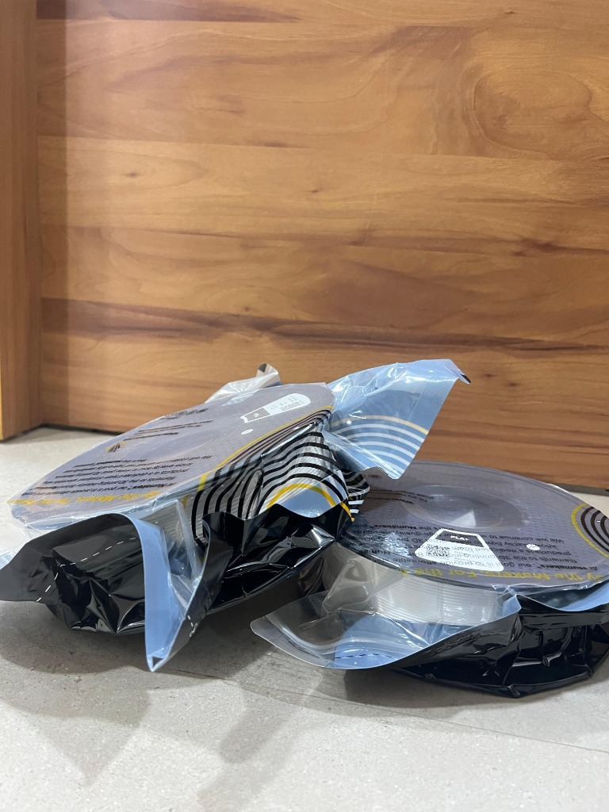
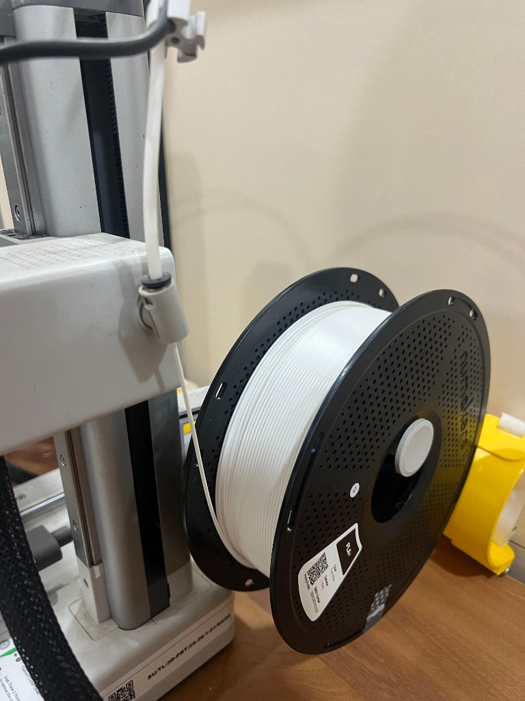
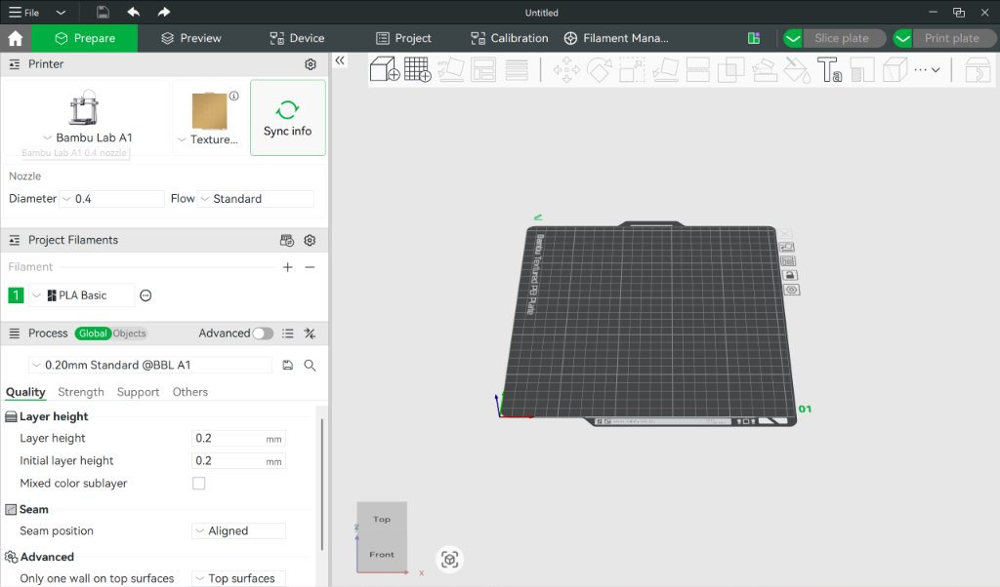
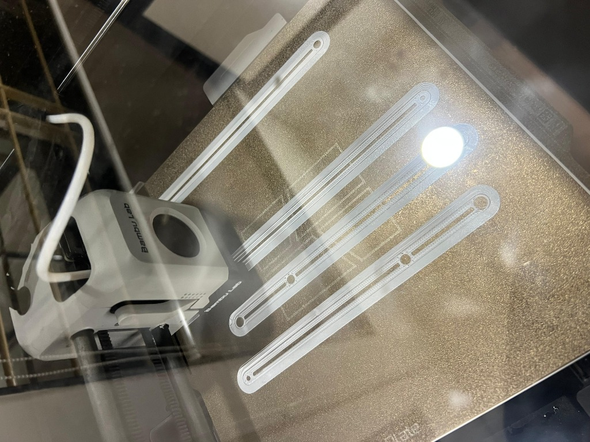
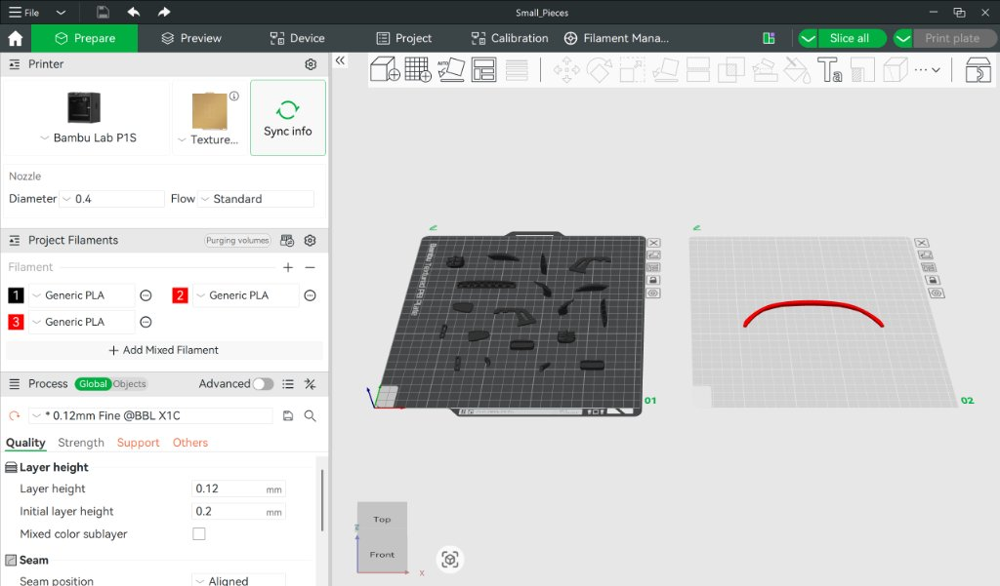
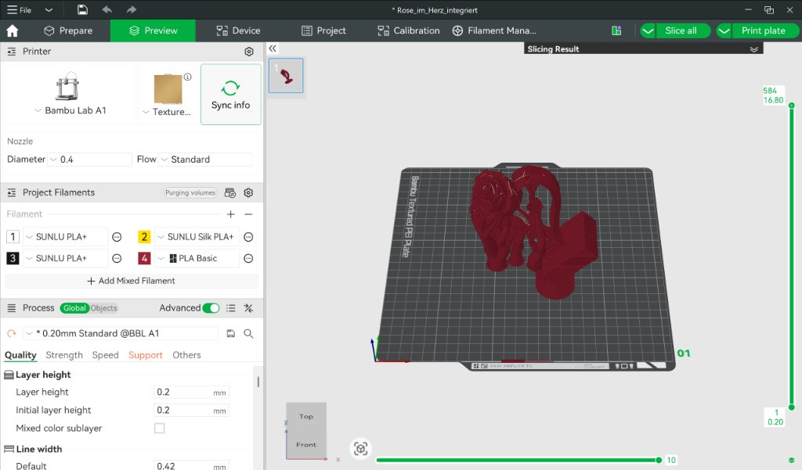
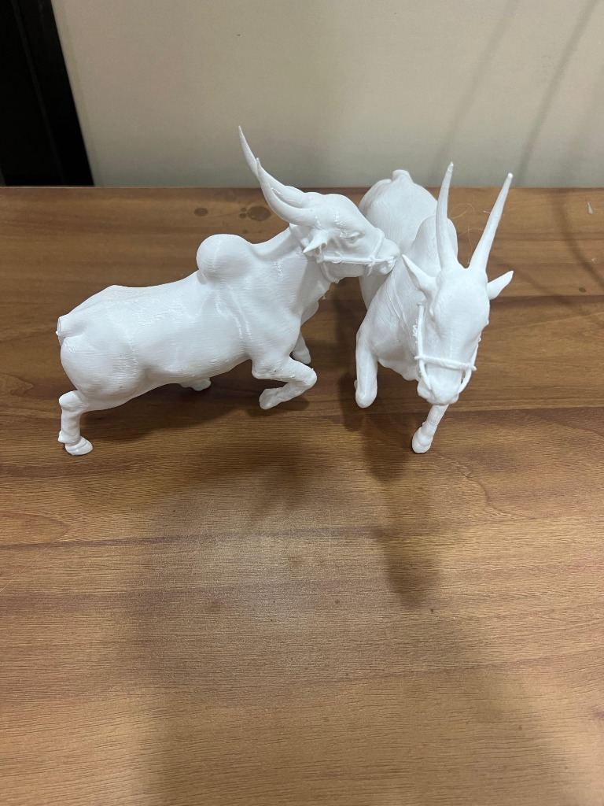

# 3D Printing & Additive Manufacturing Portfolio (3D Work)
### Rapid Prototyping, CAM Slicing & High-Speed Additive Fabrication
**Department of Mechanical Engineering & Makerspace · Sanjivani University**  
*Project Contributor: Omkar Chaudhary & Team*

---

## 📌 Overview
This directory documents additive manufacturing workflows, high-speed 3D printing equipment, toolpath slicing strategies, and physical fabricated artifacts produced using professional desktop FDM (Fused Deposition Modeling) systems.

The hardware and methodologies demonstrated here served rapid iterative prototyping for customized mechanical mounts, fixtures, sensor brackets, and precision complex geometric models.

---

## ⚙️ Additive Manufacturing Hardware & CAM Specifications

| Parameter | Specification | Details |
| :--- | :--- | :--- |
| **3D Printers** | **Bambu Lab A1** & **Bambu Lab P1S** | High-speed direct-drive desktop 3D printers with active vibration compensation and automatic flow calibration. |
| **Slicing Software** | **Bambu Studio** | High-performance slicing software with multi-plate layout, custom seam orientation, and adaptive layer height optimization. |
| **Nozzle Configuration** | $0.4\text{ mm}$ Nozzle | Standard precision nozzle supporting layer heights from $0.08\text{ mm}$ to $0.28\text{ mm}$. |
| **Build Plates** | **Textured PEI Plate** | Magnetic spring steel sheet providing superior first-layer adhesion and effortless thermal part release. |
| **Primary Material** | **Numakers PLA+ (1.75mm)** | High-toughness modified polylactic acid filament stored in vacuum-sealed moisture-barrier pouches. |
| **Secondary Materials** | **SUNLU Silk PLA+**, **Generic PLA** | High-gloss aesthetic finishes and structural prototyping polymers. |

---

## 📸 Photographic Documentation & Fabrication Workflow

### 1. Material Preparation & Moisture Management

* **File:** `01_numakers_pla_plus_filament_stock.jpg`
* **Description:** Factory vacuum-sealed spools of Numakers PLA+ ($1.75\text{ mm}$) with enclosed desiccant packs. Ensures zero ambient moisture absorption, preventing steam voids, nozzle bubbling, and stringing during extrusion.

---

### 2. Spool Feed & Extruder Hardware Setup

* **File:** `02_bambu_printer_filament_feed_setup.jpg`
* **Description:** Low-friction side spool holder assembly feeding white Numakers PLA+ through a low-resistance PTFE Bowden guide tube directly into the Bambu Lab direct-drive printhead assembly.

---

### 3. CAM Slicer Workspace Calibration (Bambu Studio)

* **File:** `03_bambu_studio_workspace_setup.jpg`
* **Description:** Bambu Studio slicing workspace initialized for the **Bambu Lab A1** utilizing the gold textured PEI build plate, configured for standard $0.20\text{ mm}$ layer deposition.

---

### 4. Real-Time Extrusion & First-Layer Adhesion

* **File:** `04_bambu_lab_active_print_bed.jpg`
* **Description:** Live high-speed deposition on the heated PEI bed. Demonstrates uniform line width, accurate perimeter contours, and zero edge warping across long structural elements.

---

### 5. Multi-Part Batch Slicing for Mechanical Components (P1S)

* **File:** `05_bambu_studio_slicer_small_pieces_p1s.jpg`
* **Description:** Bambu Studio CAM optimization for **Bambu Lab P1S** CoreXY printer running a high-density build plate with over 20 discrete mechanical components sliced at ultra-fine $0.12\text{ mm}$ layer height (`@BBL X1C` profile).

---

### 6. Complex Organic Slicing & Silk Filament Profiles

* **File:** `06_bambu_studio_slicer_rose_heart.jpg`
* **Description:** Slicing of complex organic overhangs (`Rose_im_Herz_integriert`) configured with multi-material support using SUNLU Silk PLA+ for high aesthetic surface detail.

---

### 7. Fabricated Physical Artifacts: Twin Indian Zebu Cattle Sculptures

* **File:** `07_3d_printed_indian_bull_models.jpg`
* **Description:** Completed high-resolution 3D printed physical models of twin Indian Zebu / Kangayam bulls. Features sharp horn geometry, prominent hump contouring, muscular anatomical proportions, and detailed harness rope relief printed cleanly in white PLA+ without visible layer banding.

---

*© 2026 Department of Mechanical Engineering · Sanjivani University*
