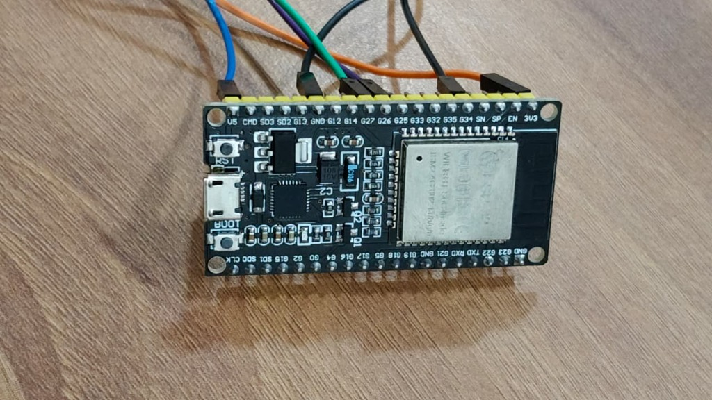
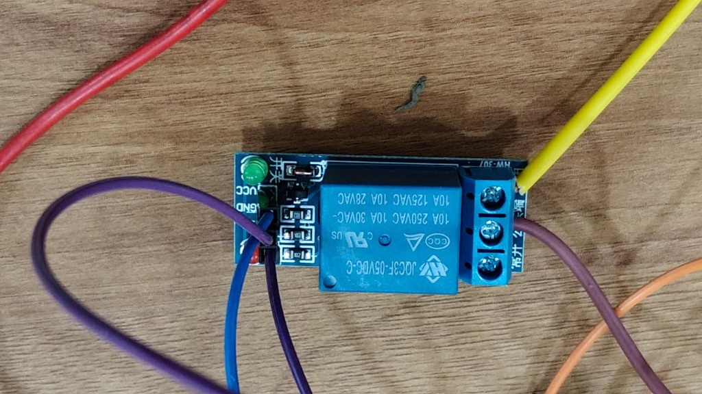
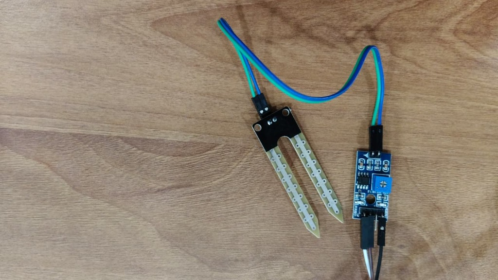
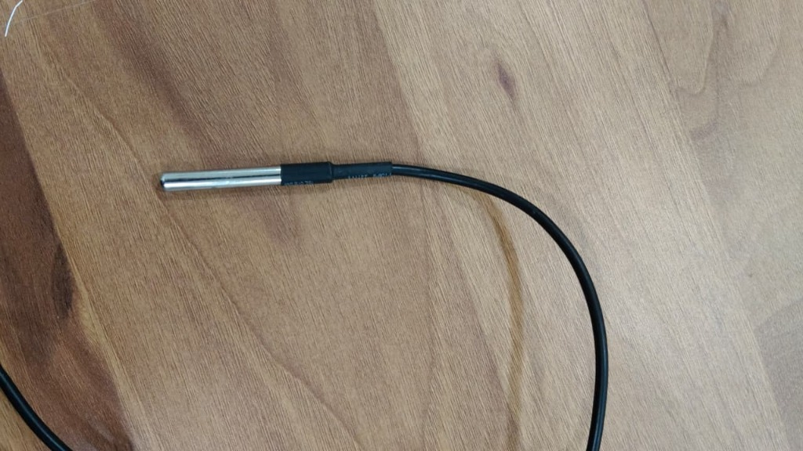
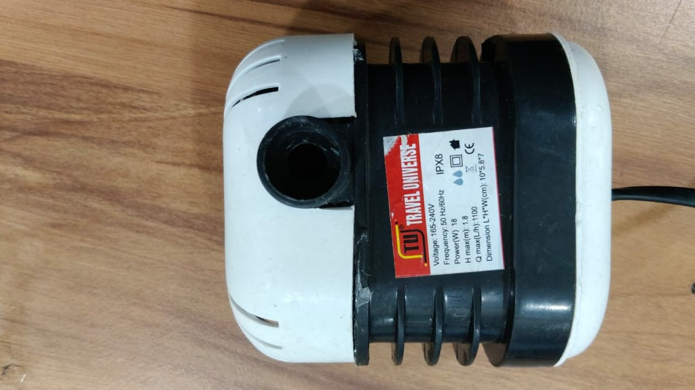
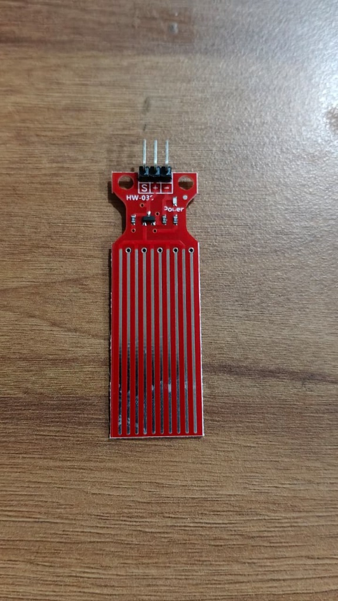

# SmartHydro IoT Hardware, Sensors & Electrical Architecture
### Component Specifications, Pin Mapping & Closed-Loop Control Hardware
**Department of Mechanical Engineering & Makerspace · Sanjivani University**  
*Project Team (Group 18): Omkar Chaudhary, Sarthak Boste, Darshan Mahajan, Rushikesh Sonawane*  
*Project Guide: Dr. Kiran Wakchaure*

---

## 📌 Overview
This directory documents the physical IoT hardware components, sensor modules, actuator electronics, and electrical wiring harnesses integrated into the **SmartHydro** automated hydroponic system.

All components were individually bench-tested, calibrated against telemetry benchmarks, and wired via DuPont harnesses to an ESP32 central processing unit mounted on the structural rig frame.

---

## ⚙️ Hardware Component Matrix & Pin Assignments

| # | Component | Manufacturer / Model | Interface / ESP32 Pin | Operating Voltage | Engineering Function |
| :-: | :--- | :--- | :--- | :---: | :--- |
| **01** | **Microcontroller Board** | **ESP32 NodeMCU (38-Pin)** | Core Processor | 5V DC (USB) / 3.3V Logic | Dual-core telemetry processing, ADC conversion, Wi-Fi logging, and relay actuation. |
| **02** | **Power Relay Module** | **JQC-3F-05VDC-C (1-Ch)** | **GPIO 26** (Digital Out) | 5V DC VCC / 3.3V Logic | Optocoupled galvanic isolation switching 230V AC / 12V DC power to the submersible pump. |
| **03** | **Soil Moisture Sensor** | **HW-103 v1.2 / LM393** | **GPIO 34** (ADC1_CH6 Analog) | 3.3V – 5V DC | Root-zone moisture saturation monitoring inside top growth pipes. |
| **04** | **Temperature Probe** | **DS18B20 Waterproof** | **GPIO 04** (1-Wire Digital) | 3.3V – 5V DC | Submerged reservoir nutrient solution thermal monitoring. |
| **05** | **Submersible Pump** | **TU Travel Universe 18W** | Switched via Relay NO | 165–240V AC (50/60Hz) | 1100 L/h hydraulic lift to deliver solution up to Pipe 1 ($H_{\max} = 1.8\text{ m}$, IPX8). |
| **06** | **Water Level Sensor** | **HW-038 Water Depth** | **GPIO 35** (ADC1_CH7 Analog) | 3.3V – 5V DC | Reservoir depth tracking & run-dry pump protection interlock. |

---

## 📸 Component Photographic Catalog

### 1. ESP32 NodeMCU 38-Pin Microcontroller Board

* **File:** `01_hw_esp32_microcontroller_board.jpg`
* **Details:** 38-pin ESP-WROOM-32 development board featuring Tensilica Xtensa 32-bit dual-core processor clocked at 240 MHz. Wired via top-side DuPont jumpers to provide low-noise ADC sampling and direct digital output control.

---

### 2. 1-Channel 5V Optocoupler Relay Module

* **File:** `02_hw_relay_module_5v.jpg`
* **Details:** Songle JQC-3F-05VDC-C power relay with optocoupler galvanic isolation. Rated for 10A 250VAC switching. Features screw terminal blocks for pump line switching and status indicator LEDs (Power & Activation).

---

### 3. Soil Moisture Sensor Probe & LM393 Comparator

* **File:** `03_hw_moisture_sensor_module.jpg`
* **Details:** Two-pronged sensor probe paired with an LM393 precision voltage comparator module. Provides analog voltage output to GPIO 34 proportional to root-zone dielectric moisture saturation.

---

### 4. DS18B20 Waterproof Temperature Sensor Probe

* **File:** `04_hw_ds18b20_temperature_probe.jpg`
* **Details:** Stainless steel encapsulated probe ($6\times50\text{ mm}$) with waterproof silicone lead. Operates over 1-Wire digital bus on GPIO 04 with $\pm0.5^\circ\text{C}$ accuracy across $-10^\circ\text{C}$ to $+85^\circ\text{C}$.

---

### 5. Submersible Water Pump (18W, 1100 L/h, IPX8)

* **File:** `05_hw_submersible_water_pump.jpg`
* **Details:** Travel Universe (TU) high-lift submersible pump. Specifications: 165–240V AC, 18W power rating, maximum head $1.8\text{ m}$, maximum discharge capacity $1100\text{ L/h}$, and IPX8 submersible waterproof certification.

---

### 6. Water Level Sensor Module (HW-038)

* **File:** `06_hw_water_level_sensor_hw038.jpg`
* **Details:** HW-038 water depth droplet sensor featuring 10 exposed parallel conducting traces. Outputs analog voltage proportional to immersion depth in the bucket reservoir. Implements **dry-run pump protection**: prevents pump actuation whenever reservoir water falls below the safe intake line.

---

*© 2026 SmartHydro Project Team (Group 18) · Department of Mechanical Engineering · Sanjivani University*
