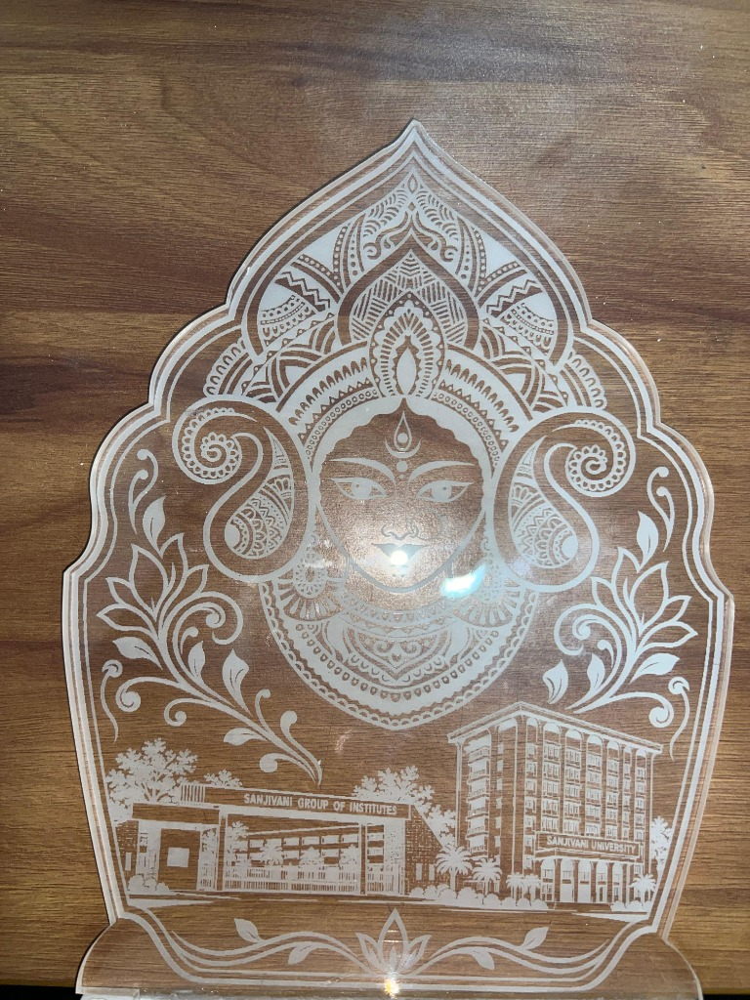
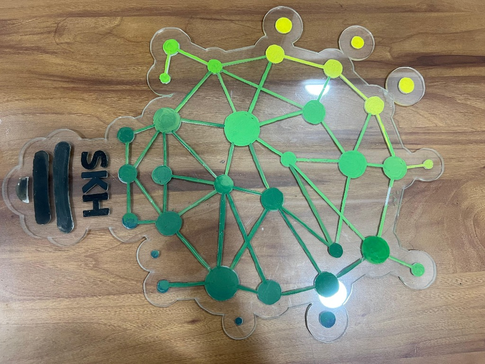
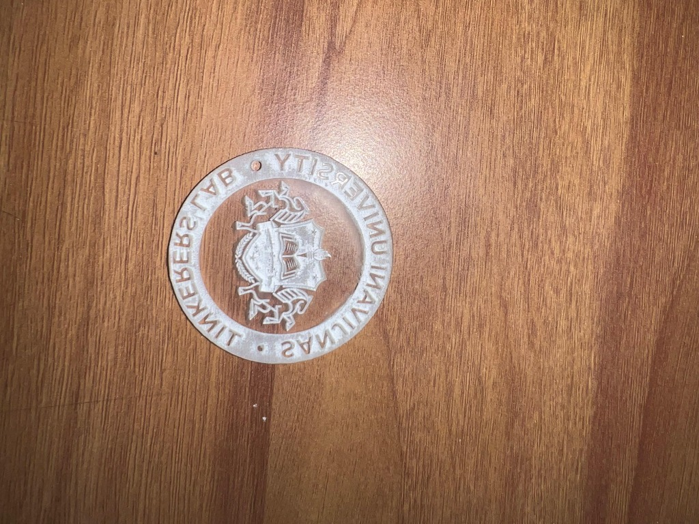
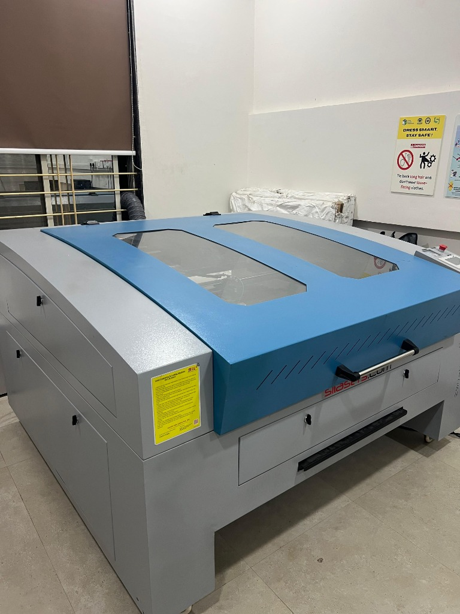
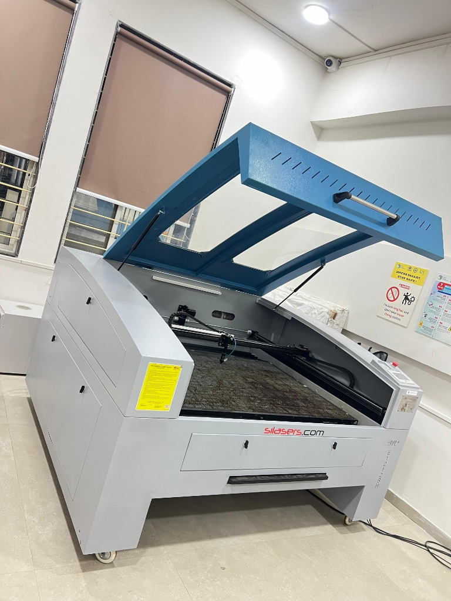
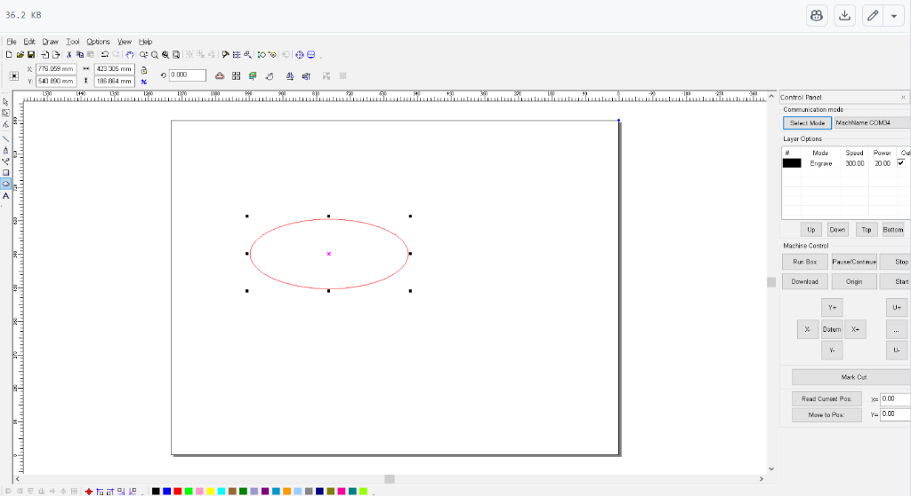
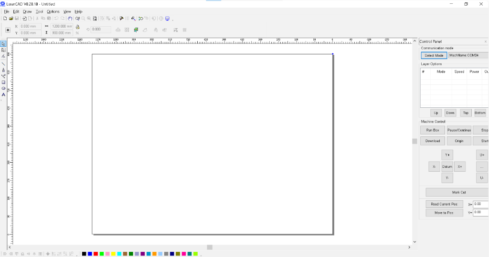
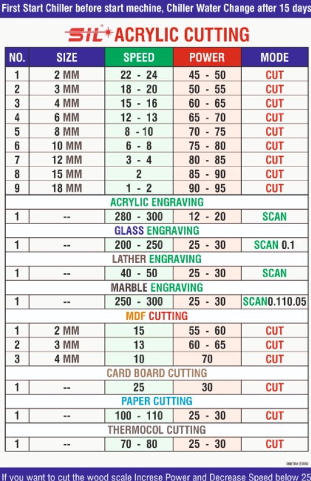
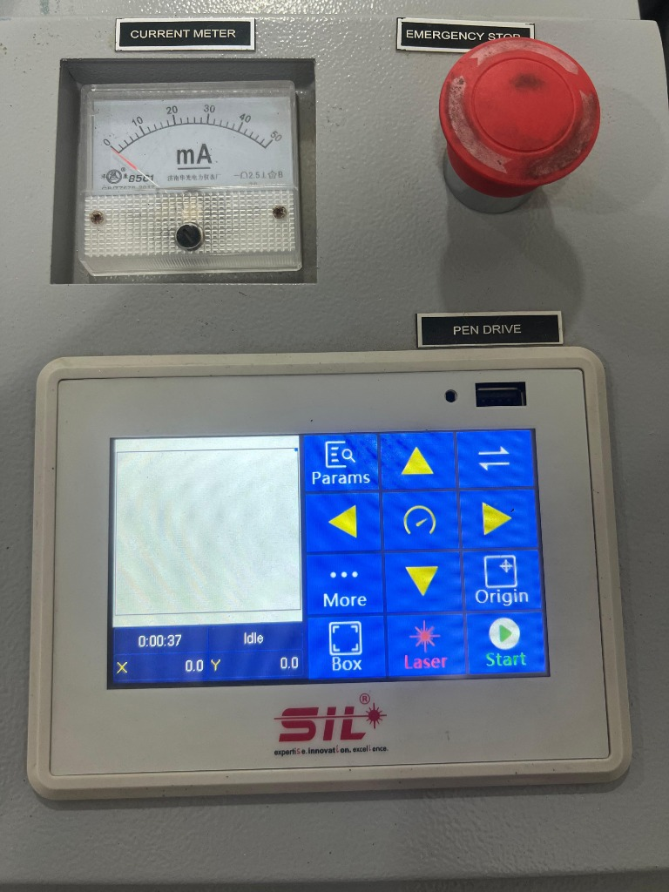

# CNC Laser Cutting & Precision Engraving Portfolio (Laser Work)
### Subtractive Digital Fabrication, CAM Toolpath Optimization & Material Calibration
**Department of Mechanical Engineering & Makerspace · Sanjivani University**  
*Project Contributor: Omkar Chaudhary & Team*

---

## 📌 Overview
This directory documents industrial CNC CO2 laser cutting and high-resolution engraving workflows conducted at the **Sanjivani University Makerspace**. 

Laser cutting provides ultra-fine kerf width, exceptional contour repeatability, and polished edge quality across non-metallic polymers, acrylics, wood, and engineering composites. These capabilities supported rapid prototyping of custom structural chassis plates, front panel instrument cutouts, precision university mementos, and IoT hardware enclosures.

---

## ⚙️ Industrial Laser Machine & CAM Specifications

| Parameter | Specification | Details |
| :--- | :--- | :--- |
| **Laser Machine System** | **SIL Industrial Flatbed Laser** | Heavy-duty industrial CNC CO2 laser cutting and engraving machine (`silasers.com`). |
| **Working Envelope / Bed Size** | **$1200\text{ mm} \times 900\text{ mm}$** ($4\times3\text{ ft}$) | Large-format cutting area accommodating full acrylic and MDF sheets. |
| **Cutting Bed Architecture** | **Honeycomb Table** | Minimizes laser beam back-reflection, aids smoke extraction, and supports small/delicate cut pieces. |
| **CAM & Control Software** | **LaserCAD V8.28.18** | Vector toolpath optimization, color-coded layer speed/power mapping, and real-time machine communication via COM34. |
| **Laser Tube Monitoring** | **0–50 mA Analog Ammeter** | In-situ monitoring of tube excitation current to ensure safe optical operating limits. |
| **Control Console** | **SIL DSP Color Touchscreen** | Jog positioning (X/Y/U/Z), Origin setting, Box boundary test, Laser test pulse, and Pen Drive USB offline transfer. |
| **Cooling & Safety** | **Industrial Closed-Loop Water Chiller** | Mandatory chiller pre-start protocol (*"First Start Chiller before start machine, Chiller Water Change after 15 days"*), gas-spring interlock hood, and red mushroom emergency stop. |

---

## 📊 SIL Operational Material Speed & Power Calibration Chart

Engineering reference parameters calibrated for precise cut kerf and clean raster engraving:

| Material | Thickness / Type | Cutting Speed (mm/s) | Power (%) | Operation Mode |
| :--- | :--- | :---: | :---: | :---: |
| **Cast Acrylic (PMMA)** | $2\text{ mm}$ | $22 - 24$ | $45 - 50$ | CUT |
| **Cast Acrylic (PMMA)** | $3\text{ mm}$ | $18 - 20$ | $50 - 55$ | CUT |
| **Cast Acrylic (PMMA)** | $4\text{ mm}$ | $15 - 16$ | $60 - 65$ | CUT |
| **Cast Acrylic (PMMA)** | $6\text{ mm}$ | $12 - 13$ | $65 - 70$ | CUT |
| **Cast Acrylic (PMMA)** | $8\text{ mm}$ | $8 - 10$ | $70 - 75$ | CUT |
| **Cast Acrylic (PMMA)** | $10\text{ mm}$ | $6 - 8$ | $75 - 80$ | CUT |
| **Cast Acrylic (PMMA)** | $12\text{ mm}$ | $3 - 4$ | $80 - 85$ | CUT |
| **Cast Acrylic (PMMA)** | $15\text{ mm}$ | $2$ | $85 - 90$ | CUT |
| **Cast Acrylic (PMMA)** | $18\text{ mm}$ | $1 - 2$ | $90 - 95$ | CUT |
| **Acrylic Surface Engraving** | Surface Raster | $280 - 300$ | $12 - 20$ | SCAN |
| **Glass Engraving** | Surface Etch | $200 - 250$ | $25 - 30$ | SCAN 0.1 |
| **Leather Engraving** | Surface Marking | $40 - 50$ | $25 - 30$ | SCAN |
| **Marble Engraving** | Stone Etch | $250 - 300$ | $25 - 30$ | SCAN 0.110 |
| **MDF Board** | $2\text{ mm}$ | $15$ | $55 - 60$ | CUT |
| **MDF Board** | $3\text{ mm}$ | $13$ | $60 - 65$ | CUT |
| **MDF Board** | $4\text{ mm}$ | $10$ | $70$ | CUT |
| **Cardboard** | Standard Sheet | $25$ | $30$ | CUT |
| **Paper** | Sheet Stock | $100 - 110$ | $25 - 30$ | CUT |
| **Thermocol** | Foam Sheet | $70 - 80$ | $25 - 30$ | CUT |

*Engineering Rule: For dense timber and hardwood scaling, increase laser tube power and decrease feed speed below $25\text{ mm/s}$.*

---

## 📸 Photographic Documentation & Fabrication Workflow

### 1. Fabricated Institutional Trophy: Sanjivani Goddess Memento

* **File:** `01_laser_cut_sanjivani_goddess_memento_trophy.jpg`
* **Description:** Intricate dual-process acrylic trophy fabricated via raster engraving and vector contour cutting. Features Goddess Durga/Saraswati traditional mandala halo, ornate facial details, and lower relief engraving of the **Sanjivani Group of Institutes** and **Sanjivani University** campus architecture with floral borders.

---

### 2. IoT Network Topology Prototype: Lightbulb Brain

* **File:** `02_laser_cut_lightbulb_network_prototype.jpg`
* **Description:** Laser-cut acrylic creative prototype illustrating a networked concept in a lightbulb profile. Features multi-node interconnected webs with color-filled acrylic infill and precision base cutouts ("SKH").

---

### 3. Precision Circular University Medallion Keychain

* **File:** `03_laser_cut_sanjivani_university_crest_keychain.jpg`
* **Description:** Clear acrylic circular keychain medallion featuring mirror-inverted subsurface engraving of the **Sanjivani University** coat of arms, perimeter typography, and a laser-pierced top hole for the split-ring hardware.

---

### 4. Machine Hardware Overview: Closed Inspection Hood

* **File:** `04_sil_laser_cutting_machine_closed_overview.jpg`
* **Description:** Exterior view of the heavy-duty SIL industrial CO2 flatbed laser machine at the Makerspace with blue safety viewing hood closed, exhaust ducting, and workshop safety guidelines.

---

### 5. Cutting Chamber & Honeycomb Bed: Open View

* **File:** `05_sil_laser_cutting_machine_open_honeycomb_bed.jpg`
* **Description:** Dual pneumatic gas-spring assisted hood raised to reveal the large $1200\times900\text{ mm}$ honeycomb cutting table, linear motion guide rails, X-Y gantry carriage, and optical laser focusing nozzle.

---

### 6. LaserCAD CAM Toolpath & Layer Modulation

* **File:** `06_lasercad_cam_software_ellipse_toolpath.png`
* **Description:** LaserCAD V8 CAM interface demonstrating vector path configuration. Showcases color-coded layer setup (Red for vector cutting, Black for raster engraving at $300\text{ mm/s}$ speed and $20\%$ optical power).

---

### 7. LaserCAD Slicing Workspace & Machine Bounds

* **File:** `07_lasercad_workspace_bed_dimensions.png`
* **Description:** Digital machine envelope configuration verifying the full $1200.000\text{ mm} \times 900.000\text{ mm}$ working coordinate space connected to the controller via COM34.

---

### 8. Official SIL Laser Speed, Power & Material Matrix

* **File:** `08_sil_laser_speed_power_materials_chart.jpg`
* **Description:** Workshop engineering standard chart posted at the workstation specifying precise speed and power settings for acrylic ($2-18\text{ mm}$), MDF, glass, leather, marble, cardboard, and paper, including chiller maintenance intervals.

---

### 9. Digital DSP Controller Console, Ammeter & E-Stop

* **File:** `09_sil_laser_dsp_controller_console.jpg`
* **Description:** Hardware operator interface featuring the SIL DSP digital color LCD controller with manual jog buttons, top-mounted $0-50\text{ mA}$ analog laser tube current meter, USB Pen Drive direct transfer port, and prominent red emergency stop switch.

---

*© 2026 Department of Mechanical Engineering · Sanjivani University*
