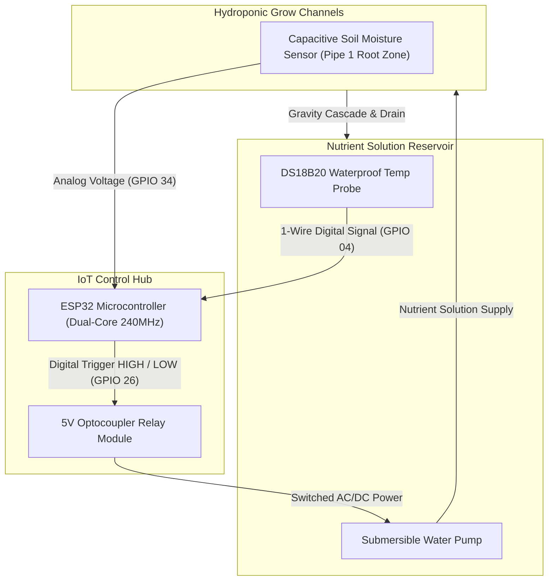

# SmartHydro: IoT-Based Smart Hydroponic Farming System with Automatic Water Circulation

[](https://omkarchaudhary10.github.io/SmartHydro/)
[](https://sanjivani.edu.in)
[](https://www.solidworks.com)
[](https://www.espressif.com)
[]()

---

## 🌐 Live Interactive Portal & CAD Viewer
The complete engineering portal, 3D interactive procedural rig animation, and workshop fabrication gallery are live at:  
👉 **[https://omkarchaudhary10.github.io/SmartHydro/](https://omkarchaudhary10.github.io/SmartHydro/)**

---

## 📌 Executive Summary & Abstract
**SmartHydro** is an automated, soil-free hydroponic cultivation system engineered by **Group 18** at the **Department of Mechanical Engineering & Makerspace, Sanjivani University**. The system combines mechanical structural design, SolidWorks CAD modeling, physical workshop metal fabrication, and closed-loop IoT automation.

By utilizing vertical space and continuous real-time monitoring of root-zone soil moisture and nutrient solution temperature, SmartHydro eliminates manual irrigation, conserves up to 90% water compared to traditional soil farming, and prevents root rot through autonomous cycle coordination.


*Figure 1: Complete physical prototype assembled and operating at Sanjivani University Campus, Singnapur.*

---

## 🎯 Project Objectives
- **Automated Irrigation Control**: Automate nutrient water circulation based on real-time root-zone moisture saturation levels.
- **Continuous Thermal Monitoring**: Track reservoir water temperature continuously using a waterproof submerged probe.
- **Space-Efficient Mechanical Architecture**: Fabricate a rugged $4 \times 4 \times 2\text{ ft}$ welded Mild Steel (MS) structure housing 20 net pots in a vertical 4-tier zigzag layout.
- **Closed-Loop IoT Architecture**: Integrate an ESP32 microcontroller with galvanic isolation via a 5V relay module for pump actuation.
- **Academic Documentation & Open Engineering**: Provide full SolidWorks CAD part models, workshop fabrication logs, and interactive web tools.

---

## 📐 SolidWorks CAD & Mechanical Specifications

The mechanical assembly was modeled and stress-verified in **Dassault Systèmes SolidWorks** prior to workshop cutting and fabrication.


*Figure 2: SolidWorks Master Assembly (`Assem_final.SLDASM`) showing structural frame, 4-tier zigzag channels, supply riser, and right reservoir bucket.*

### Verified Engineering Specifications:
| Parameter | Specification | Engineering Description |
| :--- | :--- | :--- |
| **Structural Frame Dimensions** | $4\text{ ft} \times 4\text{ ft} \times 2\text{ ft}$ ($1219 \times 1219 \times 610\text{ mm}$) | Rectangular Mild Steel (MS) square pipe stand with welded rigid joints. |
| **Growth Channels** | 4 Horizontal Pipes (3-inch / 75 mm PVC) | 4 tiers arranged in alternating front-to-back zigzag for balanced load and plant spacing. |
| **Vertical Pitch (Center-to-Center)** | $9\text{ inches}$ ($228.6\text{ mm}$) | Optimized vertical clearance ensuring adequate sunlight and air circulation between tiers. |
| **Channel Orientation** | Pipe 1 (Front) $\rightarrow$ Pipe 2 (Back) $\rightarrow$ Pipe 3 (Front) $\rightarrow$ Pipe 4 (Back) | Alternating front-to-back layout distributes weight evenly across the welded base. |
| **Plant Capacity** | 20 Plants (5 Net Pots per Pipe) | $3\text{-inch}$ apertures cut along the top spine of each pipe fitted with hydroponic net cups. |
| **Reservoir Container** | Calibrated Buffer Bucket | Positioned on the floor to the immediate right of the frame for pump suction and drain collection. |
| **Hydraulic Riser Pipe** | Straight Orthogonal Supply Line | Delivers nutrient solution from submersible pump up to the Pipe 1 top inlet. |
| **Inter-Tier Drainage** | Flexible Elbow Hose Loops | Transfers gravity-fed solution sequentially between adjacent tiers down to Pipe 4. |
| **Return Drain Line** | Horizontal Return Fitting | Channels effluent from Pipe 4 discharge back into the right reservoir container. |

---

## ⚡ IoT Hardware & Automation Architecture

The automation sub-system is driven by an **ESP32 Dual-Core Microcontroller** executing closed-loop threshold control algorithms.



### Component Hardware Map & Pin Assignment:
| Component | Function / Role | ESP32 Pin / Interface | Operating Voltage |
| :--- | :--- | :--- | :--- |
| **ESP32 Development Board** | Main IoT Controller & Logic Processing | Core Microcontroller | 5V DC via Micro-USB |
| **1-Channel 5V Relay Module** | Galvanically isolated motor switching | **GPIO 26** (Digital Output) | 5V DC VCC / 3.3V Logic |
| **Capacitive Moisture Sensor v1.2** | Real-time root-zone moisture telemetry | **GPIO 34** (ADC1_CH6 Analog In) | 3.3V DC |
| **DS18B20 Waterproof Probe** | Nutrient solution temperature tracking | **GPIO 04** (1-Wire Digital Bus) | 3.3V – 5V DC |
| **Submersible Water Pump** | Pressurized hydraulic delivery to top pipe | Switched via Relay NO Contacts | 165–240V AC (18W, IPX8) |
| **HW-038 Water Level Sensor** | Reservoir fluid depth & run-dry protection | **GPIO 35** (ADC1_CH7 Analog In) | 3.3V – 5V DC |
| **Hydroponic Net Cups** | Inert clay pebble / root support mesh | Mechanical Mounting (5/pipe) | N/A |

👉 **[📂 Explore the Complete IoT Hardware & Electronics Directory](Electronics/)**

### Closed-Loop Control Logic:
1. **Continuous Acquisition**: ESP32 continuously samples root-zone moisture via GPIO 34 and reservoir depth via GPIO 35.
2. **Run-Dry Failsafe Interlock**: If the HW-038 level sensor detects insufficient water volume in the bucket reservoir, the ESP32 automatically locks out pump actuation to prevent cavitation and burnout.
3. **Moisture Depletion Trigger**: When moisture drops below the calibrated lower threshold ($ADC > \text{Dry Threshold}$) AND water level is safe, the ESP32 sets **GPIO 26 HIGH**.
4. **Relay Activation**: The relay closes contacts with optocoupler galvanic isolation, starting the submersible pump.
5. **Hydraulic Circulation**: Nutrient water is pumped up through the vertical riser to Pipe 1 and cascades by gravity through Pipe 2, Pipe 3, and Pipe 4.
6. **Optimal Moisture Cut-Off**: Once root sensors detect adequate moisture saturation, GPIO 26 is pulled **LOW**, de-energizing the relay to stop irrigation and promote root oxygenation.
7. **Thermal Guard**: Continuous temperature tracking alerts if the solution exceeds recommended root threshold ($> 26^\circ\text{C}$).

---

## 🛠️ Physical Fabrication & Workshop Journey

The prototype was constructed by Group 18 at the **Sanjivani University Makerspace**:

1. **Material Sizing & Pipe Cutting**: Mild steel square hollow sections ($1\times1\text{ in}$) cut to $4\text{ ft}$ and $2\text{ ft}$ lengths using an abrasive chop saw.
2. **Welding & Frame Fabrication**: Manual metal arc welding (MMAW) performed to construct the $4 \times 4 \times 2\text{ ft}$ structural stand with horizontal crossbars.
3. **Weld Polishing & Surface Finishing**: Weld slag chipped, ground flush using an angle grinder, and polished smooth.
4. **Corrosion-Resistant Coating**: Application of industrial anti-rust primer followed by protective gloss coating for humid greenhouse durability.
5. **PVC Pipe Slot Cutting**: Four 3-inch PVC pipes measured and drilled with hole-saw cutters to create 5 equally spaced net-cup apertures per tier ($9\text{ in}$ center-to-center pitch).
6. **Hydraulic Plumb & Loop Assembly**: Installation of inter-tier elbow hoses, vertical supply riser, and gravity return drain line to the right bucket reservoir.
7. **Sensors & Electronics Integration**: Housing ESP32, relay module, and waterproof wiring harnesses onto protective side frame mounts.

---

## 🖨️ 3D Printing & Additive Rapid Prototyping Laboratory (`3D work/`)

In addition to structural metal fabrication, rapid prototyping was conducted at the Makerspace using high-speed desktop Fused Deposition Modeling (FDM) systems for customized fixtures, brackets, material handling studies, and precision anatomical modeling.

👉 **[📂 Explore the Complete 3D Work Directory & Documentation](3D%20work/)**

### Additive Manufacturing Equipment & CAM Slicing:
| Parameter | Specification | Details |
| :--- | :--- | :--- |
| **3D Printers** | **Bambu Lab A1** & **Bambu Lab P1S** | High-speed direct-drive desktop 3D printers with active vibration compensation and automatic flow calibration. |
| **CAM Slicing Engine** | **Bambu Studio** | High-precision slicing with 0.12mm Fine and 0.20mm Standard process profiles, custom seam placement, and multi-plate support. |
| **Extruder / Nozzle** | $0.4\text{ mm}$ Nozzle | High-efficiency direct-drive extrusion with PTFE Bowden guide tube. |
| **Build Surface** | **Textured PEI Plate** | Magnetic spring steel sheet offering robust first-layer thermal adhesion and self-releasing cool down. |
| **Primary Polymer** | **Numakers PLA+ ($1.75\text{ mm}$)** | High-toughness modified PLA preserved in factory vacuum seals with silica gel desiccant packs. |
| **Specialty Polymers** | **SUNLU Silk PLA+**, **Generic PLA** | Aesthetic silk finishes and structural functional pieces. |

### Process & Artifact Documentation:
| # | Step / Artifact | Image | Technical Description |
| :-: | :--- | :---: | :--- |
| **01** | **Filament Inventory & Moisture Control** | `01_numakers_pla_plus_filament_stock.jpg` | Vacuum-sealed Numakers PLA+ spools with desiccant packs to prevent hydrolysis, bubbling, and nozzle jams. |
| **02** | **Spool Mount & PTFE Guide Setup** | `02_bambu_printer_filament_feed_setup.jpg` | Low-friction side spool bracket feeding 1.75mm filament through smooth PTFE tubing directly to the direct-drive toolhead. |
| **03** | **Bambu Studio CAM Workspace** | `03_bambu_studio_workspace_setup.jpg` | Digital slicing workspace configured for the Bambu Lab A1 on the gold textured PEI plate at 0.20mm Standard height. |
| **04** | **In-Situ High-Speed Printing** | `04_bambu_lab_active_print_bed.jpg` | Live deposition on heated PEI bed demonstrating sharp corners, uniform line width, and zero edge warping. |
| **05** | **P1S Multi-Part Batch Slicing** | `05_bambu_studio_slicer_small_pieces_p1s.jpg` | Bambu Studio CAM layout on Bambu Lab P1S slicing 20+ mechanical pieces at ultra-fine 0.12mm layer height. |
| **06** | **Complex Organic Slicing** | `06_bambu_studio_slicer_rose_heart.jpg` | Multi-material toolpath slicing for intricate organic geometry (Rose in Heart) using Silk PLA+ for high surface gloss. |
| **07** | **Twin Indian Zebu Bull Sculptures** | `07_3d_printed_indian_bull_models.jpg` | Finished physical high-resolution 3D printed twin Indian Zebu cattle models in white PLA+ with sharp horns, muscular contouring, and halter relief. |

---

## 🔬 CNC Laser Cutting & Precision Engraving Laboratory (`Laser Work/`)

In addition to additive manufacturing and welding, subtractive digital fabrication was performed at the Makerspace using a heavy-duty industrial CO2 laser cutting system for precision acrylic front panels, structural mounting plates, university mementos, and IoT enclosures.

👉 **[📂 Explore the Complete Laser Work Directory & Documentation](Laser%20Work/)**

### Industrial Laser Machine & CAM Specifications:
| Parameter | Specification | Details |
| :--- | :--- | :--- |
| **Laser Cutting System** | **SIL Industrial Flatbed Laser** | Heavy-duty industrial CNC CO2 laser cutting and engraving machine (`silasers.com`). |
| **Working Envelope / Bed Size** | **$1200\text{ mm} \times 900\text{ mm}$** ($4\times3\text{ ft}$) | Large-format cutting area accommodating standard acrylic and MDF sheet stock. |
| **Bed Architecture** | **Honeycomb Table** | Prevents laser beam back-reflection, aids smoke evacuation, and supports small/delicate parts. |
| **CAM Software** | **LaserCAD V8.28.18** | Color-coded vector layer mapping (Red for Cut, Black for Raster Engraving at $300\text{ mm/s}$). |
| **Laser Tube Monitoring** | **$0–50\text{ mA}$ Analog Ammeter** | Real-time monitoring of tube current to prevent overdrive and optimize optical tube life. |
| **Control Console** | **SIL DSP Color Touchscreen** | Jog positioning, Origin setting, Box boundary test, Laser test pulse, and Pen Drive USB offline transfer. |
| **Cooling & Safety** | **Industrial Closed-Loop Water Chiller** | Chiller pre-start interlock, 15-day water refresh protocol, exhaust extraction, and emergency stop. |

### Process & Artifact Documentation:
| # | Step / Artifact | Image | Technical Description |
| :-: | :--- | :---: | :--- |
| **01** | **Sanjivani Goddess Memento Trophy** | `01_laser_cut_sanjivani_goddess_memento_trophy.jpg` | Dual-process acrylic memento featuring Goddess Durga/Saraswati traditional mandala halo and engraved Sanjivani University campus architecture. |
| **02** | **IoT Lightbulb Network Prototype** | `02_laser_cut_lightbulb_network_prototype.jpg` | Laser-cut acrylic creative prototype illustrating a networked concept with color-filled nodal connections and SKH cutout. |
| **03** | **Sanjivani University Crest Keychain** | `03_laser_cut_sanjivani_university_crest_keychain.jpg` | Clear acrylic circular keychain medallion featuring mirror-inverted subsurface engraving of the Sanjivani University coat of arms. |
| **04** | **SIL Industrial Laser System Overview** | `04_sil_laser_cutting_machine_closed_overview.jpg` | Exterior view of the heavy-duty SIL industrial CO2 flatbed laser machine at the Makerspace with blue safety viewing hood closed. |
| **05** | **1200 × 900 mm Honeycomb Bed** | `05_sil_laser_cutting_machine_open_honeycomb_bed.jpg` | Dual pneumatic gas-spring hood raised revealing the large honeycomb table, linear motion guide rails, and optical laser head. |
| **06** | **LaserCAD V8 Toolpath Modulation** | `06_lasercad_cam_software_ellipse_toolpath.png` | LaserCAD V8 CAM interface showing vector path configuration (Red vector cut, Black scan engrave at $300\text{ mm/s}$, $20\%$ power). |
| **07** | **Machine Coordinate Configuration** | `07_lasercad_workspace_bed_dimensions.png` | Digital machine envelope configuration verifying the full $1200.000\text{ mm} \times 900.000\text{ mm}$ coordinate bounds on COM34. |
| **08** | **SIL Speed & Power Standard Chart** | `08_sil_laser_speed_power_materials_chart.jpg` | Workshop engineering matrix specifying speed and power settings for acrylic ($2-18\text{ mm}$), MDF, glass, leather, marble, cardboard, and paper. |
| **09** | **DSP Controller, Ammeter & E-Stop** | `09_sil_laser_dsp_controller_console.jpg` | Machine operator interface with SIL DSP color LCD, $0-50\text{ mA}$ analog laser tube current meter, USB Pen Drive port, and emergency stop. |

---

## 📁 Repository Directory Structure

```text
SmartHydro/
├── 3D work/
│   ├── README.md
│   ├── 01_numakers_pla_plus_filament_stock.jpg
│   ├── 02_bambu_printer_filament_feed_setup.jpg
│   ├── 03_bambu_studio_workspace_setup.jpg
│   ├── 04_bambu_lab_active_print_bed.jpg
│   ├── 05_bambu_studio_slicer_small_pieces_p1s.jpg
│   ├── 06_bambu_studio_slicer_rose_heart.jpg
│   └── 07_3d_printed_indian_bull_models.jpg
├── Laser Work/
│   ├── README.md
│   ├── 01_laser_cut_sanjivani_goddess_memento_trophy.jpg
│   ├── 02_laser_cut_lightbulb_network_prototype.jpg
│   ├── 03_laser_cut_sanjivani_university_crest_keychain.jpg
│   ├── 04_sil_laser_cutting_machine_closed_overview.jpg
│   ├── 05_sil_laser_cutting_machine_open_honeycomb_bed.jpg
│   ├── 06_lasercad_cam_software_ellipse_toolpath.png
│   ├── 07_lasercad_workspace_bed_dimensions.png
│   ├── 08_sil_laser_speed_power_materials_chart.jpg
│   └── 09_sil_laser_dsp_controller_console.jpg
├── Electronics/
│   ├── README.md
│   ├── 01_hw_esp32_microcontroller_board.jpg
│   ├── 02_hw_relay_module_5v.jpg
│   ├── 03_hw_moisture_sensor_module.jpg
│   ├── 04_hw_ds18b20_temperature_probe.jpg
│   ├── 05_hw_submersible_water_pump.jpg
│   └── 06_hw_water_level_sensor_hw038.jpg
├── assets/
│   └── images/
│       ├── electronics/
│       │   ├── 01_hw_esp32_microcontroller_board.jpg
│       │   ├── 02_hw_relay_module_5v.jpg
│       │   ├── 03_hw_moisture_sensor_module.jpg
│       │   ├── 04_hw_ds18b20_temperature_probe.jpg
│       │   ├── 05_hw_submersible_water_pump.jpg
│       │   └── 06_hw_water_level_sensor_hw038.jpg
│       ├── cad_12_elbow_fitting.jpg
│       ├── cad_assem_final_elevation.jpg
│       ├── cad_bucket.jpg
│       ├── cad_cup1_sensor_wiring.jpg
│       ├── cad_drain_return_hose.jpg
│       ├── cad_ds18b20_temperature_probe.jpg
│       ├── cad_esp32_soil_moisture_assembly.jpg
│       ├── cad_hydro_net_cup.jpg
│       ├── cad_hydroponic_stand_assembly.jpg
│       ├── cad_hydroponic_system_stand.jpg
│       ├── cad_pipe.jpg
│       ├── cad_pipe_buttom.jpg
│       ├── cad_pipe_o2.jpg
│       ├── cad_pump_power_cable.jpg
│       ├── cad_riser_pipe_l1_supply.jpg
│       ├── cad_sensior_hydrophonic.jpg
│       ├── cad_straight_drain_fitting.jpg
│       ├── cad_submersible_pump.jpg
│       ├── workshop_cutting_frame.jpg
│       ├── workshop_cutting_pvc_slots.jpg
│       ├── workshop_finished_pvc_pipes.jpg
│       ├── workshop_frame_pipes_structure.jpg
│       ├── workshop_full_rig_assembled.jpg
│       ├── workshop_marking_pvc_pipes.jpg
│       ├── workshop_painting_frame.jpg
│       ├── workshop_polishing_frame.jpg
│       ├── workshop_welding_brackets.jpg
│       └── workshop_welding_frame.jpg
├── cad/
│   └── SmartHydro_SolidWorks_CAD_Group18.zip
├── css/
│   └── style.css
├── js/
│   ├── main.js
│   └── three-model-video.js
├── index.html
└── README.md
```

---

## 💻 Local Quickstart & Testing

To inspect or run the web portal locally:

```bash
# 1. Clone the repository
git clone https://github.com/omkarchaudhary10/SmartHydro.git

# 2. Navigate to project directory
cd SmartHydro

# 3. Start a local static HTTP server (Python 3)
python -m http.server 8080
```
Open your browser and navigate to: `http://localhost:8080`

---

## 👥 Project Team & Academic Credits

### **Academic Institution**
**Department of Mechanical Engineering & Makerspace**  
**Sanjivani University**, Kopargaon, Maharashtra, India

### **Project Guide**
* **Dr. Kiran Wakchaure** — Project Guide & Faculty Mentor

### **Project Team (Group 18)**
1. **Omkar Chaudhary**
2. **Sarthak Boste**
3. **Darshan Mahajan**
4. **Rushikesh Sonawane**

---

## 📜 License & Academic Usage
This project and its accompanying SolidWorks CAD models, schematics, and code are distributed under the **MIT License** for academic research and educational evaluation.

*© 2026 SmartHydro Project Team (Group 18) · Sanjivani University.*
