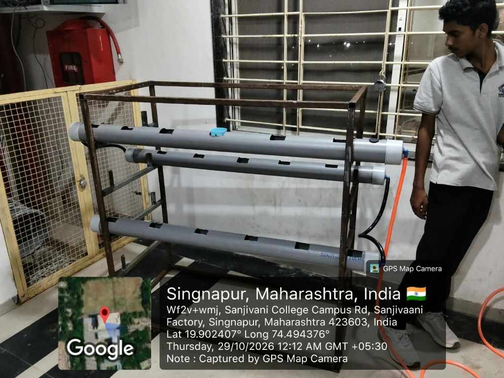
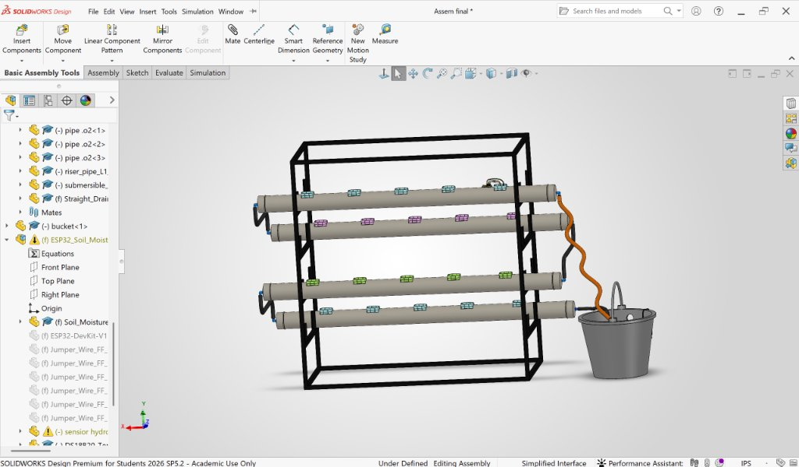
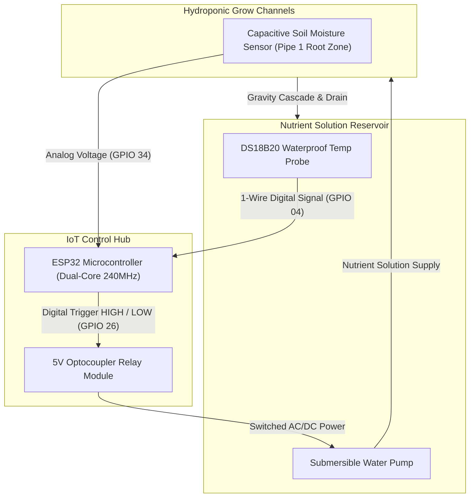

# SmartHydro: IoT-Based Smart Hydroponic Farming System with Automatic Water Circulation

[](https://omkarchaudhary10.github.io/SmartHydro/)
[](https://sanjivani.edu.in)
[](https://www.solidworks.com)
[](https://www.espressif.com)
[]()

---

## 🌐 Live Interactive Portal & CAD Viewer
The complete engineering portal, 3D interactive procedural rig animation, and workshop fabrication gallery are live at:  
👉 **[https://omkarchaudhary10.github.io/SmartHydro/](https://omkarchaudhary10.github.io/SmartHydro/)**

---

## 📌 Executive Summary & Abstract
**SmartHydro** is an automated, soil-free hydroponic cultivation system engineered by **Group 18** at the **Department of Mechanical Engineering & Makerspace, Sanjivani University**. The system combines mechanical structural design, SolidWorks CAD modeling, physical workshop metal fabrication, and closed-loop IoT automation.

By utilizing vertical space and continuous real-time monitoring of root-zone soil moisture and nutrient solution temperature, SmartHydro eliminates manual irrigation, conserves up to 90% water compared to traditional soil farming, and prevents root rot through autonomous cycle coordination.


*Figure 1: Complete physical prototype assembled and operating at Sanjivani University Campus, Singnapur.*

---

## 🎯 Project Objectives
- **Automated Irrigation Control**: Automate nutrient water circulation based on real-time root-zone moisture saturation levels.
- **Continuous Thermal Monitoring**: Track reservoir water temperature continuously using a waterproof submerged probe.
- **Space-Efficient Mechanical Architecture**: Fabricate a rugged $4 \times 4 \times 2\text{ ft}$ welded Mild Steel (MS) structure housing 20 net pots in a vertical 4-tier zigzag layout.
- **Closed-Loop IoT Architecture**: Integrate an ESP32 microcontroller with galvanic isolation via a 5V relay module for pump actuation.
- **Academic Documentation & Open Engineering**: Provide full SolidWorks CAD part models, workshop fabrication logs, and interactive web tools.

---

## 📐 SolidWorks CAD & Mechanical Specifications

The mechanical assembly was modeled and stress-verified in **Dassault Systèmes SolidWorks** prior to workshop cutting and fabrication.


*Figure 2: SolidWorks Master Assembly (`Assem_final.SLDASM`) showing structural frame, 4-tier zigzag channels, supply riser, and right reservoir bucket.*

### Verified Engineering Specifications:
| Parameter | Specification | Engineering Description |
| :--- | :--- | :--- |
| **Structural Frame Dimensions** | $4\text{ ft} \times 4\text{ ft} \times 2\text{ ft}$ ($1219 \times 1219 \times 610\text{ mm}$) | Rectangular Mild Steel (MS) square pipe stand with welded rigid joints. |
| **Growth Channels** | 4 Horizontal Pipes (3-inch / 75 mm PVC) | 4 tiers arranged in alternating front-to-back zigzag for balanced load and plant spacing. |
| **Vertical Pitch (Center-to-Center)** | $9\text{ inches}$ ($228.6\text{ mm}$) | Optimized vertical clearance ensuring adequate sunlight and air circulation between tiers. |
| **Channel Orientation** | Pipe 1 (Front) $\rightarrow$ Pipe 2 (Back) $\rightarrow$ Pipe 3 (Front) $\rightarrow$ Pipe 4 (Back) | Alternating front-to-back layout distributes weight evenly across the welded base. |
| **Plant Capacity** | 20 Plants (5 Net Pots per Pipe) | $3\text{-inch}$ apertures cut along the top spine of each pipe fitted with hydroponic net cups. |
| **Reservoir Container** | Calibrated Buffer Bucket | Positioned on the floor to the immediate right of the frame for pump suction and drain collection. |
| **Hydraulic Riser Pipe** | Straight Orthogonal Supply Line | Delivers nutrient solution from submersible pump up to the Pipe 1 top inlet. |
| **Inter-Tier Drainage** | Flexible Elbow Hose Loops | Transfers gravity-fed solution sequentially between adjacent tiers down to Pipe 4. |
| **Return Drain Line** | Horizontal Return Fitting | Channels effluent from Pipe 4 discharge back into the right reservoir container. |

---

## ⚡ IoT Hardware & Automation Architecture

The automation sub-system is driven by an **ESP32 Dual-Core Microcontroller** executing closed-loop threshold control algorithms.



### Component Hardware Map & Pin Assignment:
| Component | Function / Role | ESP32 Pin / Interface | Operating Voltage |
| :--- | :--- | :--- | :--- |
| **ESP32 Development Board** | Main IoT Controller & Logic Processing | Core Microcontroller | 5V DC via Micro-USB |
| **Capacitive Moisture Sensor v1.2** | Real-time root-zone moisture telemetry | **GPIO 34** (ADC1_CH6 Analog In) | 3.3V DC |
| **DS18B20 Waterproof Probe** | Nutrient solution temperature tracking | **GPIO 04** (1-Wire Digital Bus) | 3.3V – 5V DC |
| **1-Channel 5V Relay Module** | Galvanically isolated motor switching | **GPIO 26** (Digital Output) | 5V DC VCC / 3.3V Logic |
| **Submersible Water Pump** | Pressurized hydraulic delivery to top pipe | Switched via Relay NO Contacts | 12V DC / 230V AC |
| **Hydroponic Net Cups** | Inert clay pebble / root support mesh | Mechanical Mounting (5/pipe) | N/A |

### Closed-Loop Control Logic:
1. **Continuous Acquisition**: ESP32 continuously samples root-zone moisture via GPIO 34 ADC readings.
2. **Moisture Depletion Trigger**: When moisture drops below the calibrated lower threshold ($ADC > \text{Dry Threshold}$), the ESP32 sets **GPIO 26 HIGH**.
3. **Relay Activation**: The relay closes contacts with optocoupler galvanic isolation, starting the submersible pump.
4. **Hydraulic Circulation**: Nutrient water is pumped up through the vertical riser to Pipe 1 and cascades by gravity through Pipe 2, Pipe 3, and Pipe 4.
5. **Optimal Moisture Cut-Off**: Once root sensors detect adequate moisture saturation, GPIO 26 is pulled **LOW**, de-energizing the relay to stop irrigation and promote root oxygenation.
6. **Thermal Guard**: Continuous temperature tracking alerts if the solution exceeds recommended root threshold ($> 26^\circ\text{C}$).

---

## 🛠️ Physical Fabrication & Workshop Journey

The prototype was constructed by Group 18 at the **Sanjivani University Makerspace**:

1. **Material Sizing & Pipe Cutting**: Mild steel square hollow sections ($1\times1\text{ in}$) cut to $4\text{ ft}$ and $2\text{ ft}$ lengths using an abrasive chop saw.
2. **Welding & Frame Fabrication**: Manual metal arc welding (MMAW) performed to construct the $4 \times 4 \times 2\text{ ft}$ structural stand with horizontal crossbars.
3. **Weld Polishing & Surface Finishing**: Weld slag chipped, ground flush using an angle grinder, and polished smooth.
4. **Corrosion-Resistant Coating**: Application of industrial anti-rust primer followed by protective gloss coating for humid greenhouse durability.
5. **PVC Pipe Slot Cutting**: Four 3-inch PVC pipes measured and drilled with hole-saw cutters to create 5 equally spaced net-cup apertures per tier ($9\text{ in}$ center-to-center pitch).
6. **Hydraulic Plumb & Loop Assembly**: Installation of inter-tier elbow hoses, vertical supply riser, and gravity return drain line to the right bucket reservoir.
7. **Sensors & Electronics Integration**: Housing ESP32, relay module, and waterproof wiring harnesses onto protective side frame mounts.

---

## 📁 Repository Directory Structure

```text
SmartHydro/
├── assets/
│   └── images/
│       ├── cad_12_elbow_fitting.jpg
│       ├── cad_assem_final_elevation.jpg
│       ├── cad_bucket.jpg
│       ├── cad_cup1_sensor_wiring.jpg
│       ├── cad_drain_return_hose.jpg
│       ├── cad_ds18b20_temperature_probe.jpg
│       ├── cad_esp32_soil_moisture_assembly.jpg
│       ├── cad_hydro_net_cup.jpg
│       ├── cad_hydroponic_stand_assembly.jpg
│       ├── cad_hydroponic_system_stand.jpg
│       ├── cad_pipe.jpg
│       ├── cad_pipe_buttom.jpg
│       ├── cad_pipe_o2.jpg
│       ├── cad_pump_power_cable.jpg
│       ├── cad_riser_pipe_l1_supply.jpg
│       ├── cad_sensior_hydrophonic.jpg
│       ├── cad_straight_drain_fitting.jpg
│       ├── cad_submersible_pump.jpg
│       ├── workshop_cutting_frame.jpg
│       ├── workshop_cutting_pvc_slots.jpg
│       ├── workshop_finished_pvc_pipes.jpg
│       ├── workshop_frame_pipes_structure.jpg
│       ├── workshop_full_rig_assembled.jpg
│       ├── workshop_marking_pvc_pipes.jpg
│       ├── workshop_painting_frame.jpg
│       ├── workshop_polishing_frame.jpg
│       ├── workshop_welding_brackets.jpg
│       └── workshop_welding_frame.jpg
├── cad/
│   └── SmartHydro_SolidWorks_CAD_Group18.zip
├── css/
│   └── style.css
├── js/
│   ├── main.js
│   └── three-model-video.js
├── index.html
└── README.md
```

---

## 💻 Local Quickstart & Testing

To inspect or run the web portal locally:

```bash
# 1. Clone the repository
git clone https://github.com/omkarchaudhary10/SmartHydro.git

# 2. Navigate to project directory
cd SmartHydro

# 3. Start a local static HTTP server (Python 3)
python -m http.server 8080
```
Open your browser and navigate to: `http://localhost:8080`

---

## 👥 Project Team & Academic Credits

### **Academic Institution**
**Department of Mechanical Engineering & Makerspace**  
**Sanjivani University**, Kopargaon, Maharashtra, India

### **Project Guide**
* **Dr. Kiran Wakchaure** — Project Guide & Faculty Mentor

### **Project Team (Group 18)**
1. **Omkar Chaudhary**
2. **Sarthak Boste**
3. **Darshan Mahajan**
4. **Rushikesh Sonawane**

---

## 📜 License & Academic Usage
This project and its accompanying SolidWorks CAD models, schematics, and code are distributed under the **MIT License** for academic research and educational evaluation.

*© 2026 SmartHydro Project Team (Group 18) · Sanjivani University.*
